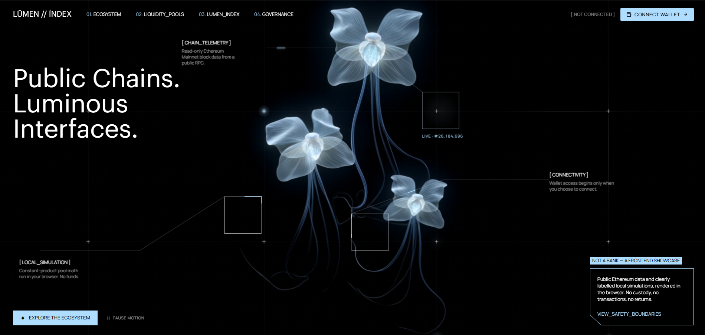

# LŪMEN // ÍNDEX

**Public chains. Luminous interfaces.**

[**↗ Live demo**](https://lumen-index-web3.vercel.app) · [Features](#features) · [Tech stack](#tech-stack) · [Run locally](#run-locally)

An immersive, **frontend-only Web3 engineering showcase** combining real Ethereum Mainnet data, wallet connectivity, blockchain exploration and interactive cryptography labs. Built with React and TypeScript — no application backend, database or custody; Google Analytics only counts visits.

> **What is real?** Chain data and balances are fetched from Ethereum Mainnet. Liquidity and governance examples are clearly labeled local simulations. All blockchain interactions are read-only, except for a separately consented, plain-text message-signing demonstration. No transactions, swaps, approvals or transfers.

## Features

| Module | What you can explore |
| --- | --- |
| **01 / Ecosystem** | Live block telemetry, 10 recent Ethereum blocks, block details, interactive base-fee history and transaction lookup with ERC-20 event decoding. |
| **02 / Liquidity Pools** | Local constant-product AMM simulator: adjustable reserves, swap amount, direction and fee; output, spot prices, price impact and a reactive SVG curve. **Demo — no funds.** |
| **03 / Lumen Index** | Connect MetaMask or another injected EIP-1193 wallet, or inspect any public Ethereum address without connecting. View Mainnet ETH, USDC, DAI and WETH balances. |
| **04 / Governance** | Cast, change and reset a single local demo vote. Opt-in Signature Lab demonstrates EIP-191 message signing and local signer verification with viem. **Not an on-chain vote or login.** |

**Motion is part of the data experience.** New blocks, wallet state changes, exploration and interactions trigger subtle SVG/CSS signals throughout the interface. Animations honor `prefers-reduced-motion` and can be paused manually.

## Tech stack

| Area | Technologies |
| --- | --- |
| Frontend | React 18, TypeScript, Vite, Tailwind CSS |
| Web3 | wagmi, viem, injected wallets (EIP-1193 / EIP-6963), Ethereum JSON-RPC, ERC-20, Multicall3 |
| Data | TanStack Query, typed read-only RPC calls, bigint-safe amount formatting |
| UI & motion | CSS animations, SVG, lucide-react, accessibility and responsive layouts |
| Quality | Vitest, browser interaction tests, opt-in live Mainnet tests, GitHub Actions CI |
| Hosting | Static frontend on Vercel |

## Run locally

Requires Node.js 22 and npm.

~~~bash
git clone https://github.com/MarinaMerkotan/lumen-index.git
cd lumen-index
npm ci
npm run dev
~~~

Open the localhost URL shown by Vite. No API keys, database or wallet are needed to explore the public blockchain sections.

The default keyless RPC is `https://ethereum-rpc.publicnode.com`. To select another **public HTTPS** endpoint, add an optional `VITE_MAINNET_RPC_URL` to `.env.local` (see [`.env.example`](.env.example)). Never put secrets in `VITE_*` variables — Vite exposes them to browsers.

### Tests & build

~~~bash
npm test             # offline unit, component and interaction tests
npm run test:live    # opt-in: real Ethereum Mainnet RPC checks
npm run build        # TypeScript + production Vite build
npm run preview      # serve the production build locally
~~~

Live checks require RPC access and may be affected by public-provider rate limits.

## Architecture

~~~text
src/
├── components/
│   ├── ambient/       # geometric motion and shared motion state
│   ├── hero/          # luminous hero, annotations and media fallback
│   ├── layout/        # header, navigation and disclosures
│   └── ui/            # shared technical UI primitives
├── features/
│   ├── ecosystem/     # live blocks, fees, selectable block details
│   ├── transactions/  # transaction receipt and event inspection
│   ├── assets/        # public address and ERC-20 balance explorer
│   ├── wallet/        # wallet discovery, connect and account state
│   ├── liquidity/     # local AMM calculations and interactive curve
│   ├── governance/    # local single-user vote
│   └── signature-lab/ # consented message signing and local verification
├── lib/               # chains, RPC config, formatters and utilities
└── live/              # optional real-Mainnet tests
~~~

Mined block headers are cached, reads are bounded, and RPC failures are surfaced as loading, stale or error states rather than fabricated figures. No backend or indexer is required.

## Safety & privacy

- Wallet access is user-initiated. The application never requests seed phrases, private keys, token approvals or blockchain write transactions.
- The Signature Lab is optional and signs only the **exact, human-readable test message** displayed on screen after explicit consent. Verification happens locally; it does not authorize anything or log anyone in.
- Liquidity and governance are browser-only demos, not financial services or real on-chain interactions.
- The application does not persist wallet addresses, inspected addresses, votes or signatures. The public RPC, external fonts and video CDN may receive ordinary network-request metadata, including public addresses sent in RPC queries.
- **Analytics:** Google Analytics 4 (`G-HWLTMJDD76`, snippet in `index.html`) counts page visits only. It sets Google's own `_ga` cookies and receives standard browser data (IP address, device, referrer, page URL with `#section` anchors only). No custom events: nothing typed, inspected, connected or signed is sent to it. No consent banner, by owner decision.
- **Media:** the hero is streamed from a third-party video URL, with a static fallback. The right to reuse that particular video has not been independently confirmed. See [security and asset notes](docs/SECURITY.md).

## Deployment

Hosted as a static Vite app on [Vercel](https://vercel.com): build with `npm run build`, publish `dist`, use Node.js 22. No serverless functions or required environment variables. The [live demo](https://lumen-index-web3.vercel.app) is the portfolio-facing experience.

**Scope:** Ethereum Mainnet only; no ENS or WalletConnect, no USD pricing or cross-chain portfolio aggregation. The Signature Lab locally verifies ordinary EOA signatures; contract-wallet signatures are not verified in this demo.

Further context: [Product](docs/PRODUCT.md) · [Design](docs/DESIGN.md) · [Web3](docs/WEB3.md) · [Security](docs/SECURITY.md) · [Agent guidelines](AGENTS.md).

---

*LUMEN // INDEX is an independent frontend/Web3 portfolio demonstration, not a bank, investment service or deployed DeFi protocol.*
